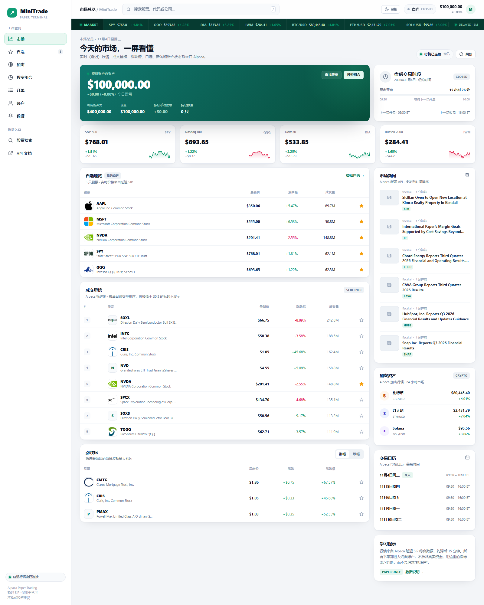
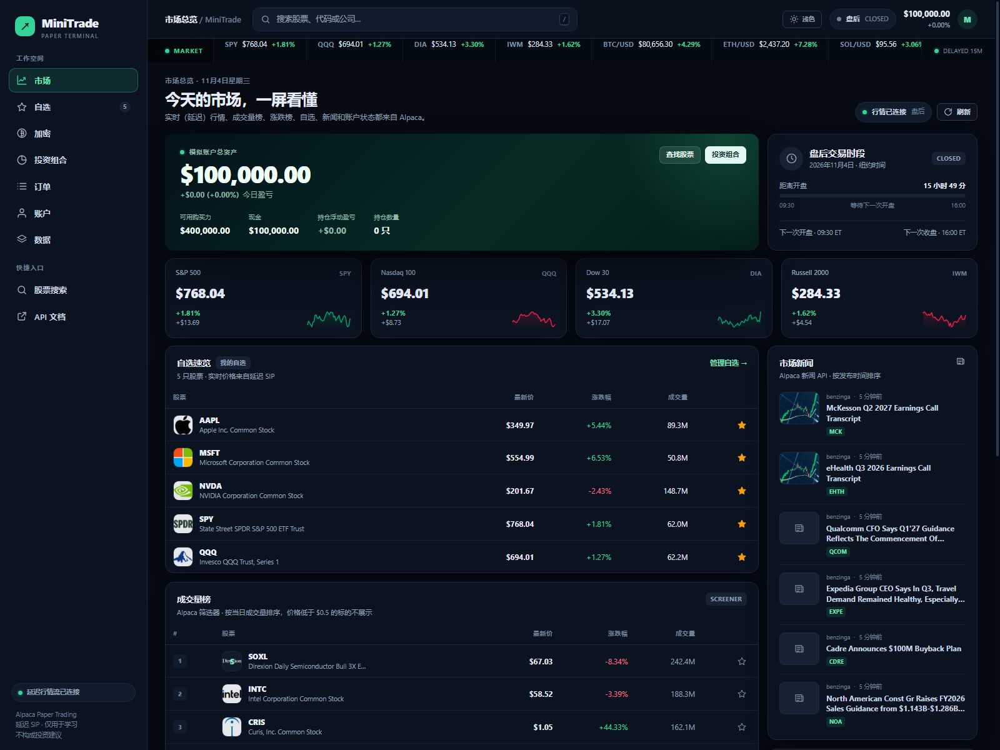
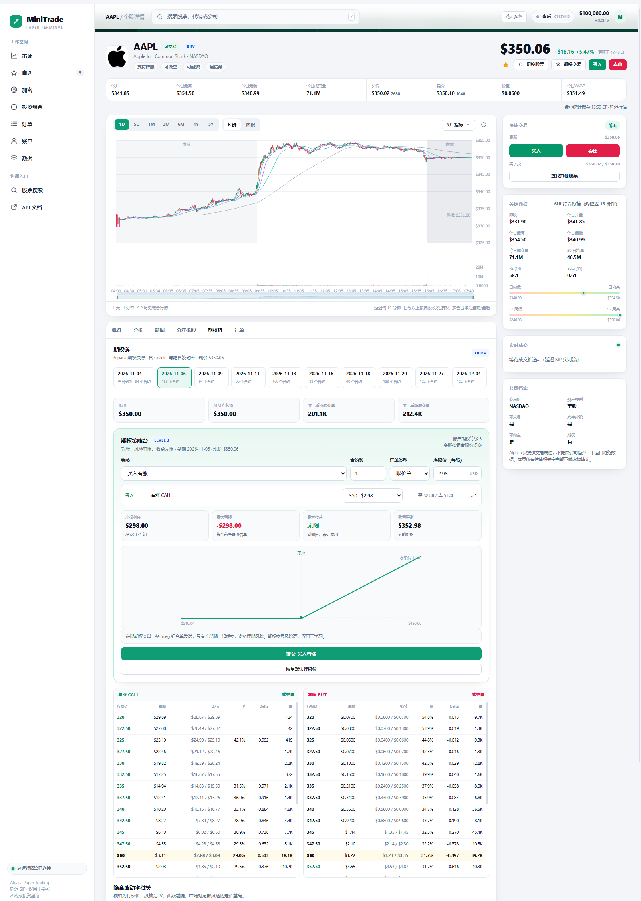
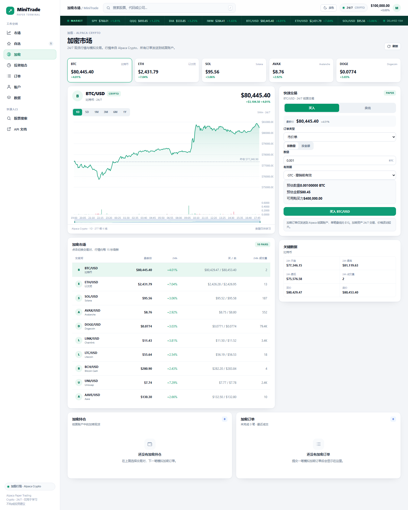

# MiniTrade 2.0

一个基于 **Alpaca Paper Trading** 的美股模拟交易终端：既像 Yahoo Finance 一样看盘、读新闻、做多维分析，也能直接在纸面账户下单。仅用于学习与模拟，不涉及真实资金。



## 功能一览

### 市场总览
- 标普 500 / 纳指 100 / 道指 / 罗素 2000 ETF 实时卡片与 30 日迷你走势
- Alpaca Screener：成交量榜、涨幅榜、跌幅榜
- 市场新闻（含图片、来源、关联代码）、加密货币行情、交易日历、市场开闭状态
- 账户资产、今日盈亏、购买力、持仓数量与自选速览
- 顶部行情跑马灯：指数与加密资产
- **浅色 / 深色主题切换**，偏好保存在浏览器；图表、卡片、导航和弹窗同步换肤



### 个股详情
- 1D / 5D / 1M / 3M / 6M / 1Y / 5Y K 线，支持蜡烛图与面积图
- 均线 MA5/10/20/50/200、布林带、RSI(14)、MACD、成交量
- 盘前/盘后灰色区间、昨收参考线、区间缩放、十字光标 OHLC 提示
- 最后一根 K 线会跟随实时成交价持续更新，同时保留你当前的缩放/平移位置
- 实时成交推送、买卖报价与价差、今日开盘/最高/最低/成交量（由分钟线推导）
- 最近逐笔 / 最近报价明细（IEX，订单 Tab 内，非 consolidated SIP）
- 区间收益、52 周高低、年化波动率、Beta、Sharpe、最大回撤、相关系数、ATR、RSI
- 多因子信号（均线结构、金叉/死叉、动量、成交量、52 周位置）
- 与 SPY/QQQ 的相对表现对比图
- 相关新闻全文、公司行动（分红/拆股）、期权链
- 快速交易与高级订单入口

### 期权链与策略台
- 到期日列表、平值行权价、看涨/看跌成交量
- 期权链：最新价、买/卖、IV、Delta、成交量；支持「ATM ±12」与「完整链」切换
- 完整链用 Alpaca 合约元数据取该到期日全部 active 行权价，再用快照补报价与 Greeks
- 隐含波动率微笑曲线（看涨/看跌）、ATM IV 期限结构（不同到期日的 ATM IV 曲线）
- ATM 合约日线（离 ATM 最近的看涨/看跌合约收盘价，1M / 3M / 6M）
- 完整链显示持仓量（`open_interest`），切换后自动滚到 ATM 行
- **期权策略台**：11 个策略——买入看涨/看跌、牛市看涨价差、熊市看跌价差、买入跨式/宽跨式、熊市看涨价差、牛市看跌价差、铁鹰、备兑看涨/保护性看跌
- 其中熊市看涨价差、牛市看跌价差、铁鹰、备兑看涨是 **credit 策略**（净收权利金），收益图按收入方向计算；备兑看涨/保护性看跌每张合约需持有 100 股正股，正股腿只进收益图、不进订单
- 到期收益图、最大盈亏、盈亏平衡点、净权利金
- 单腿和 Alpaca Level 3 `mleg` 多腿组合订单，纸面账户提交
- 期权持仓、平仓、订单状态同步
- 当日到期合约缺少 Greeks 时会明确提示并自动优先选择有 Greeks 的到期日
- **价格提醒 / 新新闻提示**：提醒规则只存本机 `localStorage`（Alpaca 没有 alert API），任何页面打开时每 60 秒用延迟行情检查，命中弹 Toast，可另开系统通知；新闻走 `/api/news` 增量轮询，只在个股页 / 自选页给「有新新闻」提示，不自动刷屏



### 加密
- 独立加密页：BTC/ETH/SOL/AVAX/DOGE/LINK/LTC/BCH/UNI/AAVE
- 24/7 快照、涨跌幅、买卖价、24h OHLC、成交量
- 1D/1W/1M/3M/6M/1Y K 线
- 市价/限价/止损限价，按数量或金额，GTC/IOC
- 加密持仓、平仓、订单列表；单笔最低约 $10
- 纸面账户 24/7 模拟交易，不涉及真实资金



### 自选
- 保存在 Alpaca 账户的多列表（创建、重命名、删除）
- 搜索添加、移除、一键加入热门股票
- 实时价格、涨跌幅、日区间/昨收、成交量、30 日迷你走势

### 投资组合
- 账户权益曲线（1D/1W/1M/3M/1Y/ALL）
- 资产配置环形图（持仓 + 现金）
- 持仓明细：成本、现价、市值、浮动盈亏、今日变化、权重
- 集中度、保证金占用、账户活动（成交/分红）

### 订单
- 股票：市价、限价、止损、止损限价、追踪止损
- 期权：单腿与 Level 3 多腿组合，限价/市价
- 加密：市价、限价、止损限价，GTC/IOC
- 数量或金额（股票市价买入/加密）、DAY/GTC/OPG/CLS/IOC/FOK
- 延长时段、碎股限制、订单类别（simple / bracket / OCO / OTO）、client_order_id、允许做空
- 未完成订单改单/取消、历史订单、成交明细（成交/分红/利息，可按时段筛选）
- 按 client order id 反查订单
- 订单更新 WebSocket：成交、部分成交、取消、拒绝

### 账户
- 账户状态、购买力结构、保证金、PDT、期权等级、加密状态
- 账户配置开关（禁止做空 / 碎股 / 隔夜 / 暂停交易 / 最大杠杆），每次只改一个字段并二次确认
- 已实现盈亏（按活动记录平均成本法估算，含分红与利息，支持 30 天 / 90 天 / 1 年 / 2 年）
- 交易日历
- 一键跳转到独立的“数据与 API”页面

### 数据与 API
- 独立的 Alpaca 能力矩阵：行情、期权、交易、工具四大类
- 每条能力的当前状态（可用 / 延迟 / 受限 / 部分 / 未接入）
- 行情流、订单流、市场状态、账户权限的实时状态卡片
- 数据延迟、复权方式、基本面缺失等限制说明
- 条件码 / 交易所代码元数据（逐笔与报价条件码，Tape A/B/C 切换）
- 系统环境与 API 文档入口


## 技术架构

```text
浏览器（Preact + HTM + ECharts，本地 vendor，无构建步骤）
        │  REST /api/*            WebSocket /ws/market, /ws/orders
        ▼
FastAPI（单进程）
  ├─ market.py    行情、K 线、分析、新闻、公司行动、Screener、加密
  ├─ options.py   期权到期日、期权链、Greeks/IV、期权订单、期权持仓
  ├─ crypto.py    加密行情、K 线、订单、持仓
  ├─ trading.py   账户、持仓、订单、活动、自选、组合历史
  ├─ streams.py   共享延迟 SIP 行情流 + 订单更新流
  ├─ analysis.py  收益、波动率、Beta、Sharpe、回撤、信号
  ├─ alpaca_api.py REST 客户端、缓存、字段归一化
  └─ cache.py     TTL 缓存
        │
        ▼
Alpaca Paper Trading + Market Data（REST / WebSocket）
```

### 实时行情设计

- 每个服务进程只维护 **一条** 上游延迟 SIP WebSocket，所有浏览器共享。
- 上游对所有订阅股票只推送 `trades`；只有当前聚焦的股票额外订阅 `quotes` 和 `bars`，避免触发 Alpaca 的订阅数量限制（代码限制 28 个符号 + 聚焦符号 2 个额外订阅）。
- 行情在服务端按约 400ms 合并成批量 `ticks` 后再下发，防止高频报价压垮 UI。
- 当前聚焦股票额外推送最近成交明细。
- 浏览器只建立一条 `/ws/market` 连接，页面切换时动态增删订阅。
- 订单更新流 `/ws/orders` 推送 Alpaca trade_updates 事件。
- 加密页走独立的 `/ws/crypto`：进程内同样只有一条上游连接，按浏览器订阅引用计数增删，断线指数退避（1/2/4→30s）；15 秒快照与 30 秒 K 线轮询保留为兜底。
- 订阅差量、重连退避、符号清洗、成交窗口是 `app/stream_logic.py` 里的纯函数，改这些决策不必连上游，`tests/test_stream_logic.py` 直接覆盖；hub 线程只负责 I/O。
- 新闻流（`wss://.../v1beta1/news`）在本账户认证订阅均成功但零推送，已改为 `/api/news` 的 60 秒增量轮询，不要重复尝试 WebSocket。

## 实现决策（改动前先看）

这些不是风格偏好，是踩过坑之后定下来的写法。改之前先读对应源码。

### 后端

- 行情统一走 `data_get`（`data.alpaca.markets`），交易走 `trading_get` / `trading_send`（`paper-api.alpaca.markets`）；失败抛 `UpstreamError`，路由层转成 `HTTPException`。
- 外部数据一律 `cache.get_or_set(key, ttl, loader, stale_ttl=...)`，不要在路由里直接打上游。缓存带 2048 条 LRU 上限（`app/cache.py`），满了先淘汰最久未用的条目。
- 字段统一用 `normalize_bar` / `normalize_order` / `normalize_position` / `normalize_snapshot` 归一化，不要另造命名。
- 历史 K 线请求 **不传 `end`**：当前订阅对"最近的 SIP 数据"会返回 403，省略 `end` 让 Alpaca 自动截到允许的延迟边界。
- bars 有分页 token，`_paged_bars` 最多翻 10 页；少了它 30 分钟/小时线只会拿到第一页。
- 日线以上用 `adjustment=all`（拆股/分红复权），分钟线用 `raw`。
- 1D 从纽约时间当天 04:00 开始（含盘前盘后），图表用 `markArea` 标灰。
- 快照的 `dailyBar` 盘中可能仍是上一交易日，所以个股页用 1D 分钟线推导今日开盘/最高/最低/成交量/VWAP（`_today_session_stats`），并标注"截至 … ET"。
- 历史逐笔/报价强制 `feed=iex` + `sort=desc`，因为当前订阅没有实时 SIP；IEX 不是 consolidated SIP，界面必须保留说明。
- 必须单个 Uvicorn worker：行情 hub 与订单流 hub 都是进程内单例，多 worker 会重复建立上游连接。
- `mleg` 的 `limit_price` 是组合**每股净价的正值**（绝对值）：credit 组合（铁鹰、信用价差）也传正数，方向由每条腿的 `side` 决定。2026-11-06 在 paper 账户实测：4 腿 credit 铁鹰传 `99.00` 返回 `accepted`；传负数会被 `OptionOrderInput` 的 `gt=0` 拒绝。不要按部分券商习惯传负号。

### 前端

- 用 `` html`...` `` 模板而不是 JSX，闭合标签写 `<//>`。
- 异步数据用 `useAsync(loader, deps, { pollMs, enabled })`；请求用 `api(path, { method, body })`；全局状态用 `useStore()` + `refreshTrading()`。
- 基础 UI 组件从 `static/js/ui.js` 取：`PageHead` / `Card` / `Badge` / `Empty` / `ErrorBanner` / `LoadingRow` / `Modal`。
- 颜色只用 CSS 变量（`var(--surface)` 等），不要硬编码浅色/深色值。
- 新增 ECharts 图必须用 `charts.js` 的 `chartColors(theme)`，并把 `theme` 放进依赖，否则切换深浅色不会重绘。
- 单列 grid 容器必须写 `grid-template-columns: minmax(0, 1fr)`：只写 `display: grid` 时列宽为 `auto`，会被内部 ECharts canvas 的宽屏初始化宽度撑开，容器宽度恒定导致 `ResizeObserver` 不触发 `chart.resize()`，窗口从宽屏缩到移动端后横向溢出且无法自愈。
- 新路由要在 `static/js/router.js` 的 `known` / `parseRoute` 和 `static/js/app.js` 的 `Page` / `TITLES` 两处同时登记。
- 路由只在 page/symbol 变化时回顶，不要每次 `hashchange` 都 `scrollTo(0)`，否则 Tab 切换会跳回顶部。
- 不要新增顶层导航项：移动端已有 7 个 nav，新功能优先放进个股 Tab、卡片或二级入口。
- 期权多腿用 `order_class=mleg` + `legs[]` + 组合净限价，`qty` 是策略组数、leg 里用 `ratio_qty`；单腿仍走普通 `/v2/orders`，`qty` 是合约数。

## Alpaca API 使用情况

| 能力 | 使用方式 | 当前账户 |
| --- | --- | --- |
| 账户 / 配置 | `GET /v2/account`, `/v2/account/configurations` | 可用 |
| 持仓 / 平仓 | `GET /v2/positions`, `DELETE /v2/positions/{symbol}` | 可用 |
| 订单 | `GET/POST/PATCH/DELETE /v2/orders`, 批量撤单 | 可用 |
| 投资组合历史 | `GET /v2/account/portfolio/history` | 可用 |
| 账户活动 | `GET /v2/account/activities` | 可用 |
| 自选列表 | `/v2/watchlists` CRUD | 可用 |
| 资产搜索 | `GET /v2/assets` | 可用（约 1.4 万个活跃美股） |
| 公司 Logo | `GET /v1beta1/logos/{symbol}` | 当前订阅 403；UI 用公开 CDN 回退 |
| 股票快照 | `GET /v2/stocks/snapshots`（`delayed_sip`） | 可用，约延迟 15 分钟 |
| 历史 K 线 | `GET /v2/stocks/bars`（1Min–1Week，SIP） | 可用 |
| 实时行情流 | `wss://stream.data.alpaca.markets/v2/delayed_sip` | 可用，延迟 |
| 实时 SIP | 实时快照 / 流 | 当前订阅不允许（403） |
| 新闻 | `GET /v1beta1/news`（含全文、图片） | 可用 |
| 筛选器 | `most-actives`, `movers` | 可用 |
| 公司行动 | `GET /v1beta1/corporate-actions` | 可用 |
| 期权快照 | `GET /v1beta1/options/snapshots/{symbol}` | 可用（OPRA，含 Greeks/IV） |
| 期权合约 | `GET /v2/options/contracts` | 可用（`status=active`；完整链用它取全部行权价） |
| 期权历史 K 线 | `GET /v1beta1/options/bars` | 可用（`1Day`，最多 4 个合约） |
| 股票历史逐笔 / 报价 | `GET /v2/stocks/trades`, `/v2/stocks/quotes` | 可用，仅 `feed=iex`（实时 SIP 403） |
| 条件码 / 交易所元数据 | `/v2/stocks/meta/conditions/{trade,quote}`, `/v2/stocks/meta/exchanges` | 可用，条件码需带 `tape` |
| 期权订单 | `POST /v2/orders`（单腿 / `mleg` 多腿） | 可用，Level 3 |
| 加密行情 | `/v1beta3/crypto/us/snapshots/bars` | 可用（10 个交易对） |
| 加密订单 | `POST /v2/orders` | 可用，纸面账户；单笔最低约 $10 |
| 市场时钟 / 日历 | `/v2/clock`, `/v2/calendar` | 可用 |
| 外汇 | `/v1beta1/forex/*` | 权限不足（403） |

## 本地运行

```powershell
cd D:\minitrade
.\.venv\Scripts\Activate.ps1
python -m pip install -r requirements.txt
python -m uvicorn app.main:app --host 127.0.0.1 --port 8000
```

打开 <http://127.0.0.1:8000>。API 文档：<http://127.0.0.1:8000/api/docs>。

只应运行 **一个 Uvicorn worker**，否则每个进程会各自建立上游行情连接。

### 重启服务

```powershell
$pid = (Get-NetTCPConnection -LocalPort 8000 -State Listen).OwningProcess
Stop-Process -Id $pid -Force
Start-Sleep -Seconds 1

$out = Join-Path $env:TEMP 'minitrade-server.out.log'
$err = Join-Path $env:TEMP 'minitrade-server.err.log'
Start-Process -FilePath 'D:\minitrade\.venv\Scripts\python.exe' `
  -ArgumentList '-m','uvicorn','app.main:app','--host','127.0.0.1','--port','8000' `
  -WorkingDirectory 'D:\minitrade' -WindowStyle Hidden `
  -RedirectStandardOutput $out -RedirectStandardError $err
```

### 连接检查

```powershell
python test_alpaca_connection.py
```

脚本只读取 `.env` 中的纸面账户密钥，输出账户状态和时钟，不会打印密钥，也不会下单。

## 配置

项目根目录 `.env`：

```text
ALPACA_API_KEY=...
ALPACA_SECRET_KEY=...
```

- 交易客户端固定使用 `https://paper-api.alpaca.markets`，代码中没有实盘切换。
- 密钥只存在于服务端进程，不发送给浏览器。
- `.env`、`.venv`、`__pycache__` 已在 `.gitignore` 中忽略。

## 项目结构

```text
.
├── app/
│   ├── main.py          # FastAPI 入口、静态资源、logo 代理、安全头
│   ├── config.py        # 常量、密钥读取、代码校验
│   ├── cache.py         # TTL 缓存
│   ├── alpaca_api.py    # REST 请求、归一化、资产/快照/搜索
│   ├── analysis.py      # 技术指标与风险计算
│   ├── market.py        # 行情、K 线、新闻、公司行动、Screener
│   ├── options.py       # 期权链、Greeks、期权订单
│   ├── crypto.py        # 加密行情、K 线、订单、持仓
│   ├── trading.py       # 账户、订单、持仓、自选、活动
│   ├── streams.py       # 行情流与订单更新流
│   ├── stream_logic.py  # 实时流纯函数（差量订阅/退避/符号清洗/成交窗口）
│   └── crypto_stream.py # 加密行情流（单条上游连接 + /ws/crypto）
├── static/
│   ├── index.html
│   ├── css/styles.css
│   ├── js/
│   │   ├── app.js          # 路由 shell、侧栏、顶栏、跑马灯、错误边界
│   │   ├── router.js       # hash 路由
│   │   ├── store.js        # 全局状态与账户/自选刷新
│   │   ├── api.js          # fetch 封装
│   │   ├── hooks.js        # useAsync / useNow / useDebounced
│   │   ├── stream.js       # 浏览器端行情流单例
│   │   ├── charts.js       # ECharts 图表与主题色
│   │   ├── indicators.js   # SMA/EMA/BOLL/RSI/MACD/ATR
│   │   ├── payoff.js       # 期权到期收益纯函数（浏览器与 node 测试共用）
│   │   ├── options-strategy.js # 期权策略台与期权持仓
│   │   ├── news.js         # 新闻增量监控（合并请求、只出计数）
│   │   ├── alerts.js       # 价格提醒 localStorage 与触发检查
│   │   ├── alert-rules.js  # 价格提醒纯规则
│   │   ├── ui.js / icons.js / theme.js / utils.js
│   │   ├── components/     # search / trade-ticket / watch-star / price-alerts
│   │   └── pages/          # market / crypto / stock / watchlist / portfolio / orders / account / data
│   └── vendor/          # Preact / HTM / ECharts 本地依赖
├── tests/
│   ├── conftest.py      # 拦截真实网络、假上游、TestClient
│   ├── test_*.py        # 后端离线回归
│   └── js/*.test.mjs    # 前端纯逻辑（node --test）
├── docs/                # 截图
├── requirements.txt
├── requirements-dev.txt # pytest + httpx
├── package.json         # 只为 "type": "module"，无构建步骤
├── test_alpaca_connection.py
└── README.md
```

## 主要 API 路由

```text
GET  /api/overview                 市场总览聚合
GET  /api/clock, /api/calendar     时钟与日历
GET  /api/quotes?symbols=&sparkline=
GET  /api/search?q=
GET  /api/stocks/{symbol}/summary
GET  /api/stocks/{symbol}/bars?range=
GET  /api/stocks/{symbol}/trades?limit=        IEX 逐笔
GET  /api/stocks/{symbol}/quotes?limit=        IEX 历史报价（不带 limit 返回最新报价）
GET  /api/stocks/{symbol}/actions
GET  /api/stocks/{symbol}/options/expirations
GET  /api/stocks/{symbol}/options/contracts?expiration=
GET  /api/stocks/{symbol}/options/chain?expiration=&full=
GET  /api/stocks/{symbol}/options/history?contracts=&range=
GET  /api/stocks/{symbol}/options/iv-term?expirations=
POST /api/stocks/{symbol}/options/orders        单腿 / mleg 期权订单
GET  /api/stocks/{symbol}/options/positions
GET  /api/crypto/markets                       加密市场
GET  /api/crypto/bars?symbol=&range=
POST /api/crypto/orders                        加密纸面订单
GET  /api/news?symbols=&limit=&content=
GET  /api/market/movers, /api/market/actives, /api/market/crypto
GET  /api/market/meta/conditions, /api/market/meta/exchanges
GET  /api/account, /api/account/config, /api/account/history
PATCH /api/account/config          账户配置（白名单字段）
GET  /api/account/realized-pnl     按代码汇总的已实现盈亏（推导）
GET  /api/positions, DELETE /api/positions/{symbol}
GET/POST/PATCH/DELETE /api/orders
GET  /api/orders/by-client-id/{client_order_id}
GET  /api/activities?types=&limit=&after=&until=&page_token=
GET/POST/PUT/DELETE /api/watchlists...
WS   /ws/market
WS   /ws/orders
```

## 测试

### 自动化回归（离线，秒级）

```powershell
python -m pip install -r requirements-dev.txt   # 仅测试用：pytest + httpx
.\.venv\Scripts\python.exe -m pytest            # 后端 189 例
node --test "tests/js/*.test.mjs"               # 前端纯逻辑 35 例
```

两者都不需要 `.env`、不需要启动服务、不联网。CI（`.github/workflows/tests.yml`）在 push / PR 上跑同样的两条命令。

- `tests/conftest.py` 把 `requests.Session.request` 全部拦截，漏 mock 的上游调用会直接失败，不会偷偷联网下单。
- 每个测试用假上游替换 `data_get` / `trading_get` / `trading_send`，只断言字段形状和业务规则。
- 覆盖：订单校验与可卖量、期权下单 payload（单腿 / mleg / OCC 解析）、实时流纯逻辑、已实现盈亏推导、bars 翻页合并、字段归一化、路由状态码与参数透传、期权收益曲线、价格提醒规则。
- **不要断言实时价格、合约数量、新闻条数**：假上游按 Alpaca 字段名构造，改归一化字段时要同步改 `tests/test_normalize.py`，否则测试会和真实返回一起腐烂。
- 改 `_validate_order` / `normalize_*` / `_paged_*` / `_derive_realized` 或对应路由后，先跑 pytest 再启动服务。

### 浏览器检查

本机可用 Playwright 做页面验证（能同时抓控制台错误，比截图可靠）：

```js
const { chromium } = require('D:/nodejs/node_modules/playwright');
// page.on('console' / 'pageerror') 收集报错
// page.on('response', r => r.status() >= 400 && ...) 抓失败请求
// page.screenshot({ path }) 截图；page.locator(...).count() 断言元素
```

Chromium 已装在 `%LOCALAPPDATA%\ms-playwright`。至少检查桌面 1600×1200 与移动 390×844 各一次，并断言 `document.documentElement.scrollWidth - clientWidth === 0`（无横向溢出），以及从宽屏缩到 390px 后仍然为 0。

### 已做过的冒烟检查

- 全部 REST 路由返回 200，核心页面无浏览器控制台异常
- 搜索 → 个股 → 买入弹窗 → 提交限价单 → 撤销的完整链路
- 期权策略台 → 单腿/多腿 mleg 订单提交 → 撤销
- 铁鹰（4 腿 credit mleg）→ 提交 → 按 client id 查回 → 撤单 → 无残留持仓（2026-11-06）
- 加密页 → 限价单提交 → 撤销；最低金额校验
- 1D/5D/1M/3M/6M/1Y K 线、MA/BOLL/RSI/MACD、期权链与 IV 微笑
- 期权合约元数据 / 完整链（持仓量 + ATM 自动居中）/ 期权日线历史 / ATM 合约日线图 / ATM IV 期限结构
- IEX 历史逐笔与历史报价；条件码与交易所元数据
- 账户配置 PATCH → GET 确认 → 恢复原值；OCO/OTO 非法组合 422；client id 查单 + 撤单
- Activities 类型/日期筛选、已实现盈亏（含 7 组合成成交单测）
- 桌面 1600px 与移动 390px 布局
- 市场页、自选、组合、订单、账户、分析、新闻、分红拆股、期权链、加密页
- 13 条路由（含个股 6 个 Tab）在桌面与移动端均无控制台报错、无失败请求、无 404 文案
- 宽屏（1600px）缩到 390px 后 `documentElement` 横向溢出为 0，ECharts canvas 跟随收缩

## 已知限制

1. **行情延迟**：当前 Alpaca 订阅为延迟 SIP，约 15 分钟；实时 SIP 需要更高数据权限。
2. **快照日线**：Alpaca 的 `dailyBar` 在盘中可能仍是上一交易日，因此个股页的“今日开/高/低/量”由分钟线实时推导；当分钟线尚未到达时为上一交易日数据，并会标注“昨”。
3. **期权**：支持纸面账户单腿/多腿下单；当日到期合约可能没有 Greeks/IV；深实值/深虚值合约也可能缺失。
4. **基本面**：Alpaca 不提供市值、PE、财报、公司简介，本终端不做虚构填充。
5. **外汇**：当前账户权限不足。
6. **碎股/延长时段**：遵循 Alpaca 限制（碎股市价 + DAY；延长时段限价 + DAY + 整数股；括号单仅买入）。
7. **单进程**：行情 hub 与订单流是进程内单例，必须使用单 worker。
8. **公司 Logo**：Alpaca 的 Logo 接口需要额外数据权限，当前订阅返回 403；UI 会回退公开 CDN，白底白字的品牌标识自动反色或改用字母卡片。
9. **加密交易**：纸面账户支持 10 个交易对；Alpaca 要求单笔金额高于约 $10，已在前端和后端校验。
10. **学习用途**：指标与信号只描述历史价格行为，不构成投资建议。
11. **IEX 逐笔/报价不完整**：当前订阅没有实时 SIP，历史 trades/quotes 只能取 IEX，不是 consolidated SIP 全市场数据，界面已标注；不要把它当权威成交。
12. **条件码需要 tape**：Alpaca 的 `/v2/stocks/meta/conditions` 会 404，必须用 `/v2/stocks/meta/conditions/{trade|quote}` 并带 `tape=A|B|C`；本地接口已封装，默认 `trade` + `C`。
13. **已实现盈亏是估算**：activities 没有成本基准字段，`/api/account/realized-pnl` 用平均成本法从 FILL 推导，按月切窗且不含手续费/税费；窗口内缺少建仓成本时返回 `null` 并说明，不猜测。
14. **OCO/OTO 限制**：主单只允许市价/限价，OCO 必须同时有止盈 + 止损，OTO 至少一个出口；这些是本地校验，避免把不确定的组合发给 Alpaca。
15. **带点号的标的期权下单会被拒**：Alpaca 的 OCC root 去点（`BRKB261120C00200000`），但 URL symbol 保留点（`BRK.B`），root 比较直接 422。修它需要 root→symbol 映射，涉及 `BRK.B` / `BF-B`。
16. **价格提醒依赖延迟行情**：`/api/quotes` 约延迟 15 分钟，且只在页面打开时每 60 秒检查一次，不能当实时止损工具。
17. **新闻不是实时推送**：见「实时行情设计」最后一条，走 60 秒增量轮询；自选页的「有新新闻」提示同理。
18. **完整链行数多**：`chain?full=true` 一次可能返回 80–100 行/侧，靠 `.option-scroll` 的 `max-height: 440px` 滚动（已做 ATM 自动居中）。不要去掉 `max-height`，否则会把页面撑爆。
19. **权益曲线稀疏**：纸面账户只有创建之后的数据点；权益长期不变时曲线接近水平线，属正常。
20. **自选有最终一致性延迟**：列表端点不返回 assets，加载后逐条 GET 详情，新增/删除后仍可能有 1–2 秒延迟。
21. **移动端表格**：自选页用 `.table-cards`，<=680px 时每行变成两列卡片、列名由 `data-label` 回放，信息不丢；其他表格（市场速览、涨跌榜、持仓、订单历史）仍隐藏次要列或横向滚动。给新表格加卡片布局时，记得同时加 `table-cards` class 和每个 `td` 的 `data-label`。

## 后续可做

当前没有待完成的开发任务。剩下的是需要外部依赖的一项：

- **基本面数据**：Alpaca 不提供市值/PE/财报，需要就接 Polygon/FMP，会增加外部依赖与密钥管理成本。

## 开发纪律

- **不接实盘**：交易端点固定 `paper-api.alpaca.markets`，代码里没有 live 开关。
- **不用假数据填充 403/404 能力**（外汇、实时 SIP、OTC、拍卖、新闻流）：拿不到就如实显示限制。
- **测试订单用远离市场的限价单**，提交后立刻撤单；每次测试结束确认没有遗留 open order / position。
- **不要用 PowerShell 的 `Get-Content` / `Set-Content` 批量改 JS/CSS**：项目是 UTF-8，那样做会造成中文乱码，用编辑器逐处修改。
- **不改 `.env`**，不在日志、截图、文档里出现密钥。
- 一个改动只碰必要的 3–5 个文件，不做顺手的大规模重构或重命名。

## 安全

- 所有 Alpaca 请求由本地后端代理，浏览器拿不到 API 密钥。
- Logo 代理只接受合法股票代码。
- 新闻 HTML 在服务端去标签后以纯文本渲染。
- 响应包含 `X-Content-Type-Options`、`Referrer-Policy`、`X-Frame-Options`。

## License

学习项目，无担保。Alpaca 账户与数据受 Alpaca 服务条款约束。
