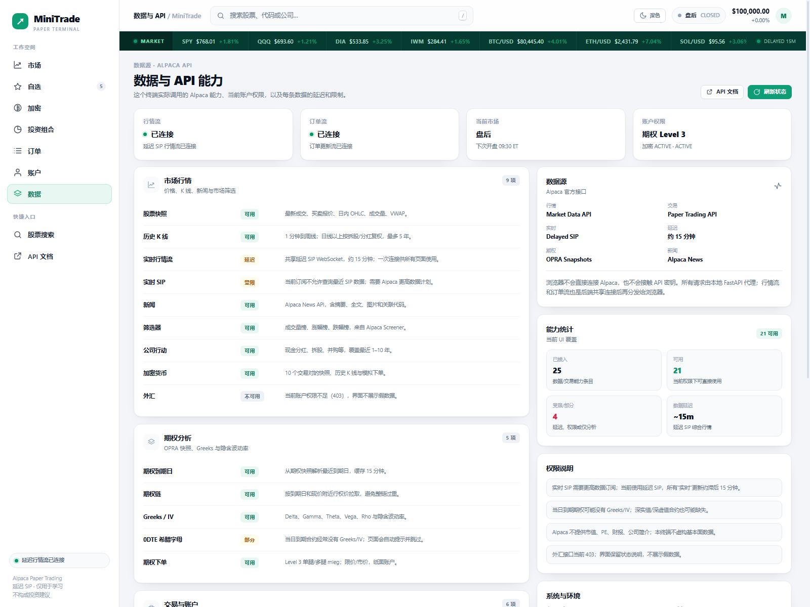

# MiniTrade 2.0

一个基于 **Alpaca Paper Trading** 的美股模拟交易终端：既像 Yahoo Finance 一样看盘、读新闻、做多维分析，也能直接在纸面账户下单。仅用于学习与模拟，不涉及真实资金。

> 下一步 P1 任务拆分与交接：[P1_HANDOFF.md](P1_HANDOFF.md)


## 功能一览

### 市场总览
- 标普 500 / 纳指 100 / 道指 / 罗素 2000 ETF 实时卡片与 30 日迷你走势
- Alpaca Screener：成交量榜、涨幅榜、跌幅榜
- 市场新闻（含图片、来源、关联代码）、加密货币行情、交易日历、市场开闭状态
- 账户资产、今日盈亏、购买力、持仓数量与自选速览
- 顶部行情跑马灯：指数与加密资产
- **浅色 / 深色主题切换**，偏好保存在浏览器；图表、卡片、导航和弹窗同步换肤


### 个股详情
- 1D / 5D / 1M / 3M / 6M / 1Y / 5Y K 线，支持蜡烛图与面积图
- 均线 MA5/10/20/50/200、布林带、RSI(14)、MACD、成交量
- 盘前/盘后灰色区间、昨收参考线、区间缩放、十字光标 OHLC 提示
- 最后一根 K 线会跟随实时成交价持续更新，同时保留你当前的缩放/平移位置
- 实时成交推送、买卖报价与价差、今日开盘/最高/最低/成交量（由分钟线推导）
- 最近逐笔 / 最近报价明细（IEX，订单 Tab 内，非 consolidated SIP）
- 区间收益、52 周高低、年化波动率、Beta、Sharpe、最大回撤、相关系数、ATR、RSI
- 多因子信号（均线结构、金叉/死叉、动量、成交量、52 周位置）
- 与 SPY/QQQ 的相对表现对比图
- 相关新闻全文、公司行动（分红/拆股）、期权链
- 快速交易与高级订单入口

### 期权链与策略台
- 到期日列表、平值行权价、看涨/看跌成交量
- 期权链：最新价、买/卖、IV、Delta、成交量；支持「ATM ±12」与「完整链」切换
- 完整链用 Alpaca 合约元数据取该到期日全部 active 行权价，再用快照补报价与 Greeks
- 隐含波动率微笑曲线（看涨/看跌）、ATM IV 期限结构（不同到期日的 ATM IV 曲线）
- ATM 合约日线（离 ATM 最近的看涨/看跌合约收盘价，1M / 3M / 6M）
- 完整链显示持仓量（`open_interest`），切换后自动滚到 ATM 行
- **期权策略台**：买入看涨/看跌、牛市看涨价差、熊市看跌价差、买入跨式/宽跨式
- 到期收益图、最大盈亏、盈亏平衡点、净权利金
- 单腿和 Alpaca Level 3 `mleg` 多腿组合订单，纸面账户提交
- 期权持仓、平仓、订单状态同步
- 当日到期合约缺少 Greeks 时会明确提示并自动优先选择有 Greeks 的到期日


### 加密
- 独立加密页：BTC/ETH/SOL/AVAX/DOGE/LINK/LTC/BCH/UNI/AAVE
- 24/7 快照、涨跌幅、买卖价、24h OHLC、成交量
- 1D/1W/1M/3M/6M/1Y K 线
- 市价/限价/止损限价，按数量或金额，GTC/IOC
- 加密持仓、平仓、订单列表；单笔最低约 $10
- 纸面账户 24/7 模拟交易，不涉及真实资金


### 自选
- 保存在 Alpaca 账户的多列表（创建、重命名、删除）
- 搜索添加、移除、一键加入热门股票
- 实时价格、涨跌幅、日区间/昨收、成交量、30 日迷你走势

### 投资组合
- 账户权益曲线（1D/1W/1M/3M/1Y/ALL）
- 资产配置环形图（持仓 + 现金）
- 持仓明细：成本、现价、市值、浮动盈亏、今日变化、权重
- 集中度、保证金占用、账户活动（成交/分红）

### 订单
- 股票：市价、限价、止损、止损限价、追踪止损
- 期权：单腿与 Level 3 多腿组合，限价/市价
- 加密：市价、限价、止损限价，GTC/IOC
- 数量或金额（股票市价买入/加密）、DAY/GTC/OPG/CLS/IOC/FOK
- 延长时段、碎股限制、订单类别（simple / bracket / OCO / OTO）、client_order_id、允许做空
- 未完成订单改单/取消、历史订单、成交明细（成交/分红/利息，可按时段筛选）
- 按 client order id 反查订单
- 订单更新 WebSocket：成交、部分成交、取消、拒绝

### 账户
- 账户状态、购买力结构、保证金、PDT、期权等级、加密状态
- 账户配置开关（禁止做空 / 碎股 / 隔夜 / 暂停交易 / 最大杠杆），每次只改一个字段并二次确认
- 已实现盈亏（按活动记录平均成本法估算，含分红与利息，支持 30 天 / 90 天 / 1 年 / 2 年）
- 交易日历
- 一键跳转到独立的“数据与 API”页面

### 数据与 API
- 独立的 Alpaca 能力矩阵：行情、期权、交易、工具四大类
- 每条能力的当前状态（可用 / 延迟 / 受限 / 部分 / 未接入）
- 行情流、订单流、市场状态、账户权限的实时状态卡片
- 数据延迟、复权方式、基本面缺失等限制说明
- 条件码 / 交易所代码元数据（逐笔与报价条件码，Tape A/B/C 切换）
- 系统环境与 API 文档入口



## 技术架构

```text
浏览器（Preact + HTM + ECharts，本地 vendor，无构建步骤）
        │  REST /api/*            WebSocket /ws/market, /ws/orders
        ▼
FastAPI（单进程）
  ├─ market.py    行情、K 线、分析、新闻、公司行动、Screener、加密
  ├─ options.py   期权到期日、期权链、Greeks/IV、期权订单、期权持仓
  ├─ crypto.py    加密行情、K 线、订单、持仓
  ├─ trading.py   账户、持仓、订单、活动、自选、组合历史
  ├─ streams.py   共享延迟 SIP 行情流 + 订单更新流
  ├─ analysis.py  收益、波动率、Beta、Sharpe、回撤、信号
  ├─ alpaca_api.py REST 客户端、缓存、字段归一化
  └─ cache.py     TTL 缓存
        │
        ▼
Alpaca Paper Trading + Market Data（REST / WebSocket）
```

### 实时行情设计

- 每个服务进程只维护 **一条** 上游延迟 SIP WebSocket，所有浏览器共享。
- 上游对所有订阅股票只推送 `trades`；只有当前聚焦的股票额外订阅 `quotes` 和 `bars`，避免触发 Alpaca 的订阅数量限制。
- 行情在服务端按约 400ms 合并成批量 `ticks` 后再下发，防止高频报价压垮 UI。
- 当前聚焦股票额外推送最近成交明细。
- 浏览器只建立一条 `/ws/market` 连接，页面切换时动态增删订阅。
- 订单更新流 `/ws/orders` 推送 Alpaca trade_updates 事件。

## Alpaca API 使用情况

| 能力 | 使用方式 | 当前账户 |
| --- | --- | --- |
| 账户 / 配置 | `GET /v2/account`, `/v2/account/configurations` | 可用 |
| 持仓 / 平仓 | `GET /v2/positions`, `DELETE /v2/positions/{symbol}` | 可用 |
| 订单 | `GET/POST/PATCH/DELETE /v2/orders`, 批量撤单 | 可用 |
| 投资组合历史 | `GET /v2/account/portfolio/history` | 可用 |
| 账户活动 | `GET /v2/account/activities` | 可用 |
| 自选列表 | `/v2/watchlists` CRUD | 可用 |
| 资产搜索 | `GET /v2/assets` | 可用（约 1.4 万个活跃美股） |
| 公司 Logo | `GET /v1beta1/logos/{symbol}` | 当前订阅 403；UI 用公开 CDN 回退 |
| 股票快照 | `GET /v2/stocks/snapshots`（`delayed_sip`） | 可用，约延迟 15 分钟 |
| 历史 K 线 | `GET /v2/stocks/bars`（1Min–1Week，SIP） | 可用 |
| 实时行情流 | `wss://stream.data.alpaca.markets/v2/delayed_sip` | 可用，延迟 |
| 实时 SIP | 实时快照 / 流 | 当前订阅不允许（403） |
| 新闻 | `GET /v1beta1/news`（含全文、图片） | 可用 |
| 筛选器 | `most-actives`, `movers` | 可用 |
| 公司行动 | `GET /v1beta1/corporate-actions` | 可用 |
| 期权快照 | `GET /v1beta1/options/snapshots/{symbol}` | 可用（OPRA，含 Greeks/IV） |
| 期权合约 | `GET /v2/options/contracts` | 可用（`status=active`；完整链用它取全部行权价） |
| 期权历史 K 线 | `GET /v1beta1/options/bars` | 可用（`1Day`，最多 4 个合约） |
| 股票历史逐笔 / 报价 | `GET /v2/stocks/trades`, `/v2/stocks/quotes` | 可用，仅 `feed=iex`（实时 SIP 403） |
| 条件码 / 交易所元数据 | `/v2/stocks/meta/conditions/{trade,quote}`, `/v2/stocks/meta/exchanges` | 可用，条件码需带 `tape` |
| 期权订单 | `POST /v2/orders`（单腿 / `mleg` 多腿） | 可用，Level 3 |
| 加密行情 | `/v1beta3/crypto/us/snapshots/bars` | 可用（10 个交易对） |
| 加密订单 | `POST /v2/orders` | 可用，纸面账户；单笔最低约 $10 |
| 市场时钟 / 日历 | `/v2/clock`, `/v2/calendar` | 可用 |
| 外汇 | `/v1beta1/forex/*` | 权限不足（403） |

## 本地运行

```powershell
cd D:\minitrade
.\.venv\Scripts\Activate.ps1
python -m pip install -r requirements.txt
python -m uvicorn app.main:app --host 127.0.0.1 --port 8000
```

打开 <http://127.0.0.1:8000>。API 文档：<http://127.0.0.1:8000/api/docs>。

只应运行 **一个 Uvicorn worker**，否则每个进程会各自建立上游行情连接。

### 连接检查

```powershell
python test_alpaca_connection.py
```

脚本只读取 `.env` 中的纸面账户密钥，输出账户状态和时钟，不会打印密钥，也不会下单。

## 配置

项目根目录 `.env`：

```text
ALPACA_API_KEY=...
ALPACA_SECRET_KEY=...
```

- 交易客户端固定使用 `https://paper-api.alpaca.markets`，代码中没有实盘切换。
- 密钥只存在于服务端进程，不发送给浏览器。
- `.env`、`.venv`、`__pycache__` 已在 `.gitignore` 中忽略。

## 项目结构

```text
.
├── app/
│   ├── main.py          # FastAPI 入口、静态资源、logo 代理、安全头
│   ├── config.py        # 常量、密钥读取、代码校验
│   ├── cache.py         # TTL 缓存
│   ├── alpaca_api.py    # REST 请求、归一化、资产/快照/搜索
│   ├── analysis.py      # 技术指标与风险计算
│   ├── market.py        # 行情、K 线、新闻、公司行动、Screener
│   ├── options.py       # 期权链、Greeks、期权订单
│   ├── crypto.py        # 加密行情、K 线、订单、持仓
│   ├── trading.py       # 账户、订单、持仓、自选、活动
│   └── streams.py       # 行情流与订单更新流
├── static/
│   ├── index.html
│   ├── css/styles.css
│   ├── js/              # 页面、组件、图表、指标、状态
│   └── vendor/          # Preact / HTM / ECharts 本地依赖
├── docs/                # 截图
├── requirements.txt
├── test_alpaca_connection.py
└── README.md
```

## 主要 API 路由

```text
GET  /api/overview                 市场总览聚合
GET  /api/clock, /api/calendar     时钟与日历
GET  /api/quotes?symbols=&sparkline=
GET  /api/search?q=
GET  /api/stocks/{symbol}/summary
GET  /api/stocks/{symbol}/bars?range=
GET  /api/stocks/{symbol}/trades?limit=        IEX 逐笔
GET  /api/stocks/{symbol}/quotes?limit=        IEX 历史报价（不带 limit 返回最新报价）
GET  /api/stocks/{symbol}/actions
GET  /api/stocks/{symbol}/options/expirations
GET  /api/stocks/{symbol}/options/contracts?expiration=
GET  /api/stocks/{symbol}/options/chain?expiration=&full=
GET  /api/stocks/{symbol}/options/history?contracts=&range=
GET  /api/stocks/{symbol}/options/iv-term?expirations=
POST /api/stocks/{symbol}/options/orders        单腿 / mleg 期权订单
GET  /api/stocks/{symbol}/options/positions
GET  /api/crypto/markets                       加密市场
GET  /api/crypto/bars?symbol=&range=
POST /api/crypto/orders                        加密纸面订单
GET  /api/news?symbols=&limit=&content=
GET  /api/market/movers, /api/market/actives, /api/market/crypto
GET  /api/market/meta/conditions, /api/market/meta/exchanges
GET  /api/account, /api/account/config, /api/account/history
PATCH /api/account/config          账户配置（白名单字段）
GET  /api/account/realized-pnl     按代码汇总的已实现盈亏（推导）
GET  /api/positions, DELETE /api/positions/{symbol}
GET/POST/PATCH/DELETE /api/orders
GET  /api/orders/by-client-id/{client_order_id}
GET  /api/activities?types=&limit=&after=&until=&page_token=
GET/POST/PUT/DELETE /api/watchlists...
WS   /ws/market
WS   /ws/orders
```

## 测试

已完成的冒烟检查：

- 全部 REST 路由返回 200，核心页面无浏览器控制台异常
- 搜索 → 个股 → 买入弹窗 → 提交限价单 → 撤销的完整链路
- 期权策略台 → 单腿/多腿 mleg 订单提交 → 撤销
- 加密页 → 限价单提交 → 撤销；最低金额校验
- 1D/5D/1M/3M/6M/1Y K 线、MA/BOLL/RSI/MACD、期权链与 IV 微笑
- 期权合约元数据 / 完整链（持仓量 + ATM 自动居中）/ 期权日线历史 / ATM 合约日线图 / ATM IV 期限结构
- IEX 历史逐笔与历史报价；条件码与交易所元数据
- 账户配置 PATCH → GET 确认 → 恢复原值；OCO/OTO 非法组合 422；client id 查单 + 撤单
- Activities 类型/日期筛选、已实现盈亏（含 7 组合成成交单测）
- 桌面 1600px 与移动 390px 布局
- 市场页、自选、组合、订单、账户、分析、新闻、分红拆股、期权链、加密页

## 已知限制

1. **行情延迟**：当前 Alpaca 订阅为延迟 SIP，约 15 分钟；实时 SIP 需要更高数据权限。
2. **快照日线**：Alpaca 的 `dailyBar` 在盘中可能仍是上一交易日，因此个股页的“今日开/高/低/量”由分钟线实时推导；当分钟线尚未到达时为上一交易日数据，并会标注“昨”。
3. **期权**：支持纸面账户单腿/多腿下单；当日到期合约可能没有 Greeks/IV；深实值/深虚值合约也可能缺失。
4. **基本面**：Alpaca 不提供市值、PE、财报、公司简介，本终端不做虚构填充。
5. **外汇**：当前账户权限不足。
6. **碎股/延长时段**：遵循 Alpaca 限制（碎股市价 + DAY；延长时段限价 + DAY + 整数股；括号单仅买入）。
7. **单进程**：行情 hub 与订单流是进程内单例，必须使用单 worker。
8. **公司 Logo**：Alpaca 的 Logo 接口需要额外数据权限，当前订阅返回 403；UI 会回退公开 CDN，白底白字的品牌标识自动反色或改用字母卡片。
9. **加密交易**：纸面账户支持 10 个交易对；Alpaca 要求单笔金额高于约 $10，已在前端和后端校验。
10. **学习用途**：指标与信号只描述历史价格行为，不构成投资建议。
11. **IEX 逐笔/报价不完整**：当前订阅没有实时 SIP，历史 trades/quotes 只能取 IEX，不是 consolidated SIP 全市场数据，界面已标注；不要把它当权威成交。
12. **条件码需要 tape**：Alpaca 的 `/v2/stocks/meta/conditions` 会 404，必须用 `/v2/stocks/meta/conditions/{trade|quote}` 并带 `tape=A|B|C`；本地接口已封装，默认 `trade` + `C`。
13. **已实现盈亏是估算**：activities 没有成本基准字段，`/api/account/realized-pnl` 用平均成本法从 FILL 推导，按月切窗且不含手续费/税费；窗口内缺少建仓成本时返回 `null` 并说明，不猜测。
14. **OCO/OTO 限制**：主单只允许市价/限价，OCO 必须同时有止盈 + 止损，OTO 至少一个出口；这些是本地校验，避免把不确定的组合发给 Alpaca。

## 安全

- 所有 Alpaca 请求由本地后端代理，浏览器拿不到 API 密钥。
- Logo 代理只接受合法股票代码。
- 新闻 HTML 在服务端去标签后以纯文本渲染。
- 响应包含 `X-Content-Type-Options`、`Referrer-Policy`、`X-Frame-Options`。

## License

学习项目，无担保。Alpaca 账户与数据受 Alpaca 服务条款约束。
